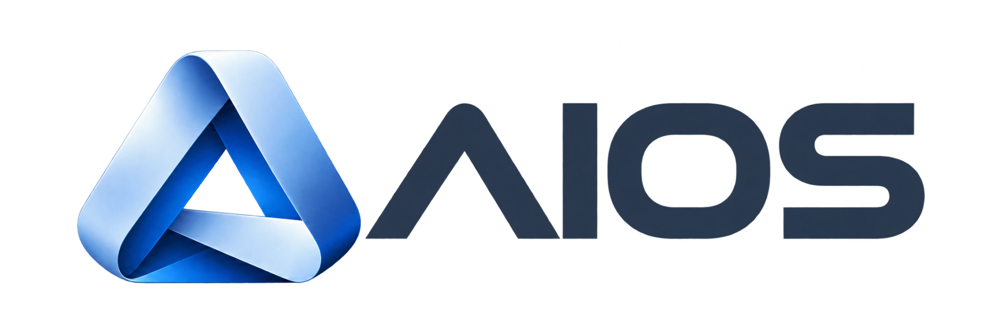

# AIOS — Sistema tipografico

**Documento:** `00_AIOS_Typography_System`  
**Versione:** v1.2 · 15 ottobre 2026  
**Sistema:** AIOS / Brand System  
**Destinazione approvata:** `00_SYSTEM/BRAND_IDENTITY/00_AIOS_Typography_System.md`  
**Stato revisione v1.2:** contenuto predisposto per applicazione manuale; non ancora applicato o pubblicato.  
**Provenienza immediata:** `03_AIOS_Typography_System_v1.1(1).md` (allegato alla micro-sessione AIOS).  
**Stato:** consolidato sul piano tipografico; nuova identità grafica integrata senza cambiare le famiglie approvate.  
**Ambito:** documentazione di regia del metasistema AIOS, sito web, app, dashboard, documenti e asset di comunicazione.  
**Fonte integrale di base:** `03_AIOS_Typography_System_v1.0(1).pdf` (5 pagine, 08.10.2026).



## Decisione tipografica ufficiale — INVARIATA

- **Geist Sans:** unica famiglia proporzionale per titoli, paragrafi, navigazione, form e interfacce AIOS.
- **IBM Plex Mono:** solo codici, trigger, identificativi tecnici e contenuti monospaziati.
- **Wordmark AIOS:** rimane un disegno grafico proprietario; non è composto in Geist o IBM Plex Mono e non deve essere ridisegnato con caratteri tipografici.
- **Manrope:** non utilizzato nell'identità AIOS, preservando la distinzione da ADEXIMA.

**Principio guida (v1.0 confermato).** Una sola voce tipografica proporzionale per l'interfaccia riduce la discontinuità tra titoli e testi rilevata nei test Sora + Inter. Il nuovo simbolo satinato non introduce alcun motivo per cambiare questa scelta.

## 01 / Famiglie, ruoli e licenze

### Geist Sans · famiglia primaria

Carattere sans-serif di impronta contemporanea e tecnica: utilizzare i pesi **400, 500, 600 e 700**, privilegiando la coerenza della famiglia rispetto ad accostamenti eterogenei. La famiglia è distribuita con licenza **SIL Open Font License 1.1**.

### IBM Plex Mono · sistema e comandi

Famiglia monospaziata per sintassi e stringhe macchina. Non utilizzare per testi lunghi o interi paragrafi informativi. Famiglia open source, disponibile anche tramite Google Fonts.

| Componente | Famiglia | Peso |
|---|---|---|
| Titoli e pagine | Geist Sans | 600–700 |
| Descrizioni e contenuti | Geist Sans | 400 |
| Menu e pulsanti | Geist Sans | 500–600 |
| Etichette e tabelle | Geist Sans | 400–500 |
| Comandi e codice | IBM Plex Mono | 400–500 |

### Firme, fallback e distribuzione

- **Wordmark:** utilizzare sempre il master grafico approvato; non digitarlo in un font. Nella v1.1 cambia soltanto il simbolo affiancato al wordmark.
- **Web/app:** preferire file WOFF2 self-hosted e risorse font locali nelle app native.
- **Fallback sul web:** `Geist, system-ui, -apple-system, Segoe UI, sans-serif`; per codice `IBM Plex Mono, ui-monospace, monospace`.
- **Licenza:** versionare i font insieme agli asset e distribuire il testo della licenza OFL con le applicazioni che li incorporano.

## 02 / Gerarchie e ritmo di lettura

Scala iniziale per design system responsive: valori da validare in prototipi reali, **non** misure minime legali.

| Ruolo | Desktop | Mobile | Peso / interlinea |
|---|---:|---:|---|
| Display / H1 | 40 px | 30 px | 700 / 1.15 |
| H2 | 30 px | 25 px | 650 / 1.22 |
| H3 | 23 px | 21 px | 600 / 1.28 |
| H4 | 19 px | 18 px | 600 / 1.30 |
| Body articolo | 17 px | 17 px | 400 / 1.65 |
| Body interfaccia | 16 px | 16 px | 400 / 1.50 |
| Label / pulsanti | 14 px | 14–16 px | 550 / 1.30 |
| Caption | 13 px | 13–14 px | 400 / 1.45 |
| Trigger / code | 14 px | 14 px | IBM Plex Mono 500 / 1.45 |

### Lettura prolungata

- Larghezza ottimale di articolo: **58–72 caratteri per riga**; evitare muri di testo su desktop.
- Per mobile non scendere sotto **16 px** per paragrafi principali; considerare 17–18 px per letture estese.
- Preferire pesi **400/500** nel corpo e **600/700** nei titoli; evitare tracking negativo nel testo ordinario.
- Il testo usa **Ink Graphite** su superfici chiare e bianco morbido su superfici dark; **Primary Slate Blue** non è il colore standard del testo lungo.

## 03 / App, dashboard e contenuti tecnici

| Contesto | Esempio | Regola |
|---|---|---|
| Navigazione | Control Room · Progetti · Osservatorio | Geist 500; selezione non soltanto cromatica |
| Pulsanti | Apri sessione / Nuovo checkpoint | Geist 550–600; testo leggibile e focus visibile |
| Dati | 12 progetti · 84 eventi | Geist + numeri tabulari quando disponibili |
| Trigger | `#start` `#session` `#state` `#switch` | IBM Plex Mono 500; blocco distinto |
| Errori | Sincronizzazione non riuscita | Testo + icona + indicazione intervento |

### Regole mobile e accessibilità

- Testare larghezze **320, 360, 390 e 430 px** e zoom testo **200%**.
- Usare `font-size` in `rem` e rispettare Dynamic Type / font scaling quando la piattaforma lo consente.
- Controllare segni accentati italiani, numeri tabulari, caratteri ambigui (`0/O`, `1/l/I`) e troncamenti.
- Minimizzare numero di font e pesi caricati; impiegare `font-display: swap` e fallback metricamente appropriati quando necessario.
- Verificare contrasto, densità tabelle e possibilità di selezionare/copiare testo nelle app.

## 04 / Implementazione e controllo

### CSS indicativo, conservato dalla v1.0

```css
@font-face {
  font-family: "Geist";
  src: url("/fonts/geist.woff2") format("woff2");
  font-style: normal; font-weight: 100 900; font-display: swap;
}
@font-face {
  font-family: "IBM Plex Mono";
  src: url("/fonts/ibm-plex-mono.woff2") format("woff2");
  font-style: normal; font-weight: 400 600; font-display: swap;
}
:root {
  --font-ui: "Geist", system-ui, sans-serif;
  --font-code: "IBM Plex Mono", ui-monospace, monospace;
}
body { font-family: var(--font-ui); font-size: 1rem; line-height: 1.55; }
h1,h2,h3 { font-family: var(--font-ui); line-height: 1.2; font-weight: 650; }
code,pre,.trigger { font-family: var(--font-code); }
```

Percorsi, nomi dei file e disponibilità dei pesi sono esempi: sostituire con file effettivamente rilasciati e verificare la sintassi `@font-face` rispetto alla build.

### Controlli prima del rilascio

- Licenze e file font nell'asset repository; nessuna dipendenza necessaria da CDN per app offline.
- Rendering verificato su Chrome, Safari iOS, Firefox e Android WebView; fallback controllato.
- Test reali: articolo lungo, dashboard densa, modulo con errori, vista mobile ingrandita, stampa PDF.
- I campioni tipografici in una brand guide sono specifiche d'impiego, non necessariamente una prova visiva realizzata con Geist effettivamente caricato; per giudicare il carattere servono prototipi con Geist reale.

### Riferimenti consolidati

- Geist e licenza: https://github.com/vercel/geist-font
- IBM Plex: https://github.com/IBM/plex
- WCAG 2.2: https://www.w3.org/TR/WCAG22/

## 05 / Integrazione della nuova firma grafica — v1.1


- **Simbolo:** il nuovo segno a nastro triangolare satinato sostituisce il precedente pittogramma quadrato come firma principale, a seguito di STP a tre livelli.
- **Wordmark:** stessi tratti, forma e proporzioni della scelta consolidata; non comporlo in Geist né in altro font.
- **Testo dell'interfaccia:** resta Geist Sans; i token cromatici e le varianti di contrasto sono definiti nel documento `00_AIOS_Visual_Identity.md`.
- **Su superfici dark:** impiegare un asset inverso del wordmark ad alta leggibilità senza cambiare la forma delle lettere; master inverso da validare separatamente.
- **Asset sorgente disponibile:** `assets/AIOS-logo-official.png`, PNG trasparente allegato e copiato senza modifiche. Non rappresenta un master vettoriale.

## Tracciabilità / CQD

- **v1.0, 08.10.2026:** approvazione famiglie Geist Sans / IBM Plex Mono, scale responsive, regole tecniche.
- **v1.1, 08.10.2026:** sostituzione delle immagini e dei riferimenti al marchio, integrazione del risultato STP e delle regole di convivenza simbolo/wordmark; **nessuna variazione delle famiglie, dei pesi, delle scale e del CSS di base**.
- Fonte originale consultata integralmente: PDF ufficiale v1.0 di 5 pagine. Tutte le sezioni operative 01–04, tabelle, criteri e riferimenti sono conservati; la sezione 05 è nuova.
- La Quick Guide generata durante l'esplorazione grafica è **esclusa** dalle fonti normative AIOS perché riportava font e colori non approvati.


## Integrazione documentale v1.2 — 15 ottobre 2026

- **Perimetro:** nuova collocazione e filename stabile in `00_SYSTEM/BRAND_IDENTITY/`; aggiornati soltanto il percorso del logo allegato, i riferimenti al documento di identità visiva e i metadati di revisione.
- **Decisioni immutate:** Geist Sans per il testo proporzionale, IBM Plex Mono per i contenuti monospaziati e wordmark grafico proprietario. Le tabelle, le scale e il CSS indicativo delle sezioni 01–04 rimangono quelli della v1.1.
- **Asset:** `assets/AIOS-logo-official.png` disponibile in copia byte-identica; master inverso per superfici dark non incluso e da validare separatamente.
- **Provenienza:** versione integrale immediata `03_AIOS_Typography_System_v1.1(1).md` ricevuta nella sessione. Il riferimento al PDF v1.0 descrive la provenienza riportata dal documento precedente, non una nuova lettura di quel PDF in questa preparazione.
- **Gate documentale:** revisione candidata fino all'applicazione manuale, ai controlli CQD locali e a commit/push verificati separatamente.

### Version history — integrazione

- **v1.2, 15.10.2026:** collocazione e riferimenti aggiornati per i PNG e il Markdown canonico; font, gerarchie, licenze dichiarate, CSS e vincoli conservati.
