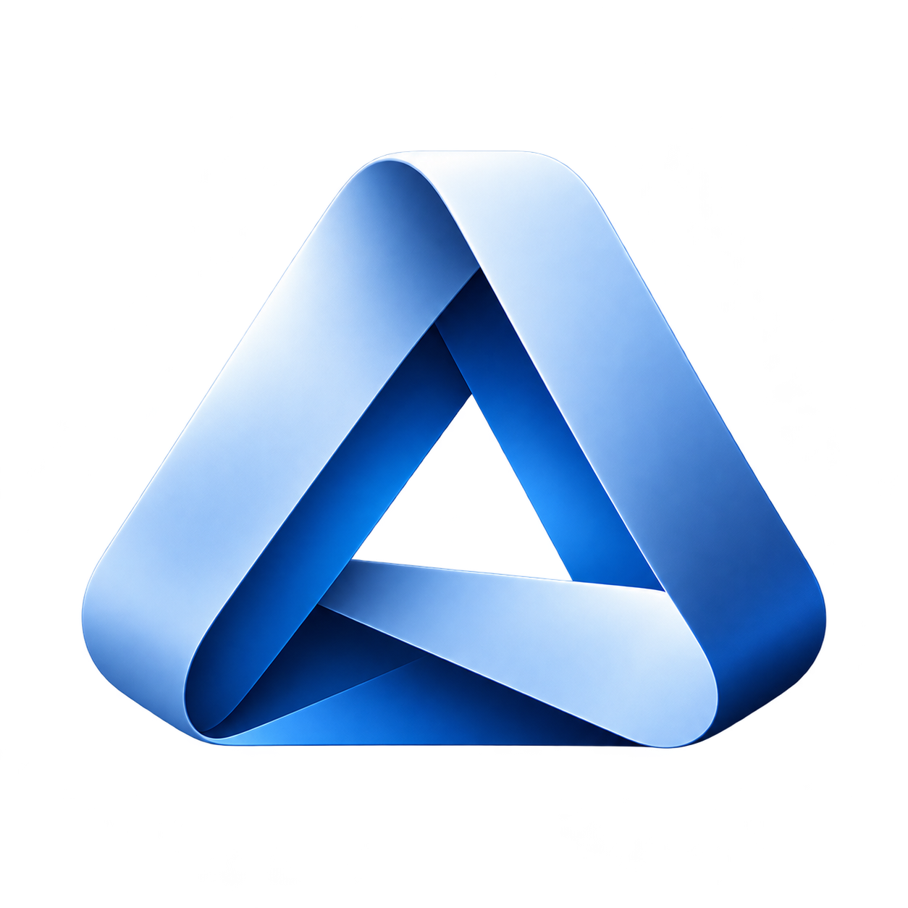
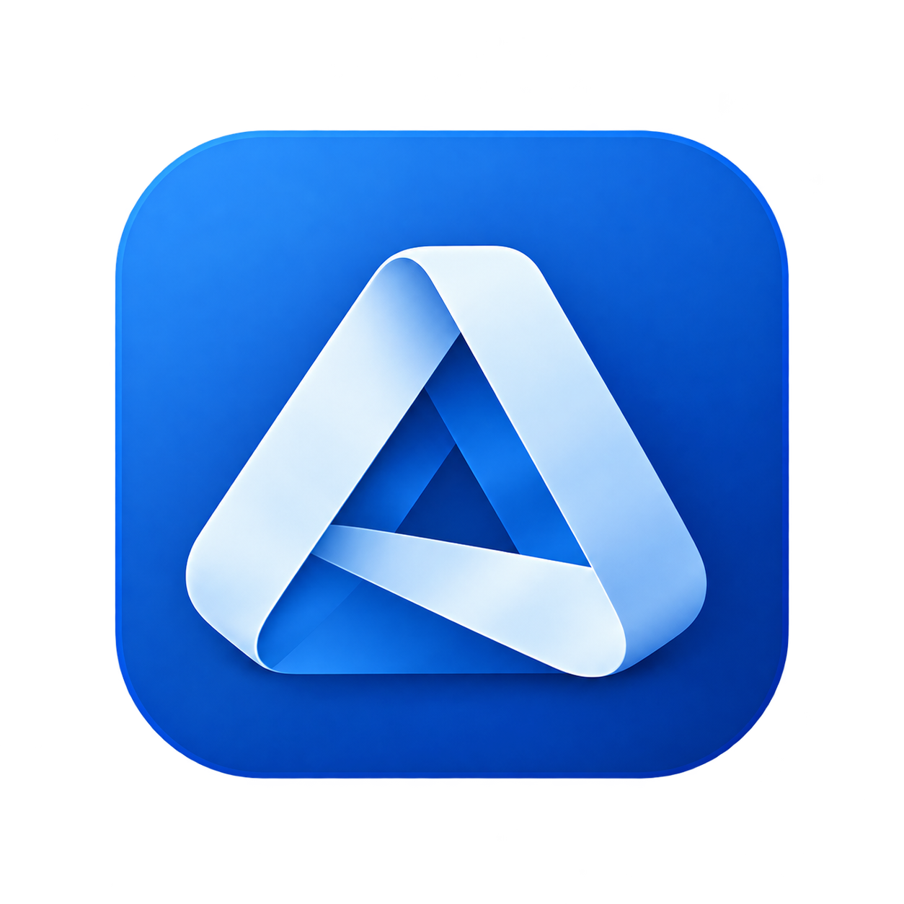

# AIOS — Sistema grafico

**Documento:** `00_AIOS_Visual_Identity`  
**Versione:** v1.2 · 15 ottobre 2026  
**Sistema:** AIOS / Brand System  
**Destinazione approvata:** `00_SYSTEM/BRAND_IDENTITY/00_AIOS_Visual_Identity.md`  
**Stato revisione v1.2:** contenuto predisposto per applicazione manuale; non ancora applicato o pubblicato.  
**Provenienza immediata:** `03_AIOS_Visual_Identity_v1.1(1).md` (allegato alla micro-sessione AIOS).  
**Stato:** nuovo simbolo satinato adottato; vincoli produttivi ancora da verificare dove indicato.  
**Ambito:** documentazione della Control Room AIOS, sito web, app, dashboard, documenti e asset di comunicazione.  
**Fonte integrale di base:** `03_AIOS_Visual_Identity_v1.0(1).pdf` (6 pagine, 08.10.2026).

## Decisioni consolidate — aggiornamento v1.1

- **Simbolo primario:** nuovo nastro triangolare intrecciato **satinato** (forme e rendering approvati dall'utente dopo iterazioni); sostituisce il precedente simbolo quadrato.
- **Wordmark AIOS:** disegno geometrico personalizzato **invariato**. Non va ricostruito usando un font.
- **Palette istituzionale:** confermata senza alcuna variazione: blu ardesia desaturato, blu profondo, grafite e neutri chiari.
- **Accenti e stati:** confermati Copper Sand / Copper Ink e i token semantici per le UI.
- **Finitura del nastro:** le sfumature satinate fanno parte dell'asset del simbolo; non sono nuovi colori istituzionali da applicare indiscriminatamente al prodotto.

**Regola madre:** forme, vuoti, intrecci e sfumature del nastro sono elementi grafici originali. Non ricostruire il marchio con caratteri tipografici, trasformazioni o gradienti inventati.

## 01 / Logo, combinazioni e comportamento

### Firma principale

Marchio orizzontale: **nuovo simbolo a sinistra, lettering proprietario a destra**. Non alterare rapporto relativo, forme o spaziature stabilite nell'asset master. Il precedente riferimento `logo_aios_con_icona_a_nastro_blu.png` è storico e viene sostituito come firma principale.

**Riferimenti digitali attuali:**

- `assets/AIOS-logo-official.png` — lockup orizzontale trasparente.
- `assets/AIOS-symbol-official.png` — simbolo standalone trasparente.
- `assets/AIOS-logo-print.png` — variante print allegata come **riferimento visivo raster**; non file vettoriale né prestampa. La corrispondenza della sua provenienza con la tavola storica non è stata nuovamente verificata in questa sessione.

### Simbolo standalone

L'intersezione dei tre lati e le sovrapposizioni interne costituiscono un tratto distintivo del nuovo marchio. Il volume è intenzionale: non deve essere rimosso nel master satinato. L'effetto 3D del simbolo, accostato al wordmark piatto, rappresenta una gerarchia voluta e accettata nello STP.

### Variante semplificata per stampa — riferimento visivo approvato

La versione di stampa selezionata è quella **in basso a destra** nella tavola `linee_guida_del_marchio_aios_in_blu_satinato.png`. È una versione semplificata del nastro chiaro all'interno di un riquadro blu con angoli arrotondati. **Non** coincide con la precedente icona quadrata del marchio v1.0.

La scelta estetica è consolidata. Il PNG allegato è un **riferimento raster**, non un master SVG/AI o un originale di prestampa verificato adatto a tutte le tecniche di stampa. Prima di timbri, serigrafia, plotter, taglio vinile o microstampa bisogna produrre e verificare un asset piatto/monocromatico vero, senza fingere che una sfumatura riprodotta equivalga a una singola tinta.

### Utilizzo su sfondo scuro

**Asset inverso non incluso:** la precedente v1.1 richiamava `assets/AIOS_Dark_Wordmark_Anteprima_NonMaster.png`, non fornito tra i tre PNG approvati per questa collocazione. Non è presente un master inverso validato.

Il simbolo mantiene il proprio rendering; **solo il lettering** può passare a una tinta chiara approvata (es. Mist White `#F3F5F8`) senza cambiarne geometria, rapporto o peso. La variante inversa resta una **soluzione funzionale da validare separatamente**, non una modifica approvata del wordmark proprietario. Evitare la versione con lettere Ink Graphite / blu scuro su sfondo simile per scarsa leggibilità.

### Regole di applicazione

- Preferire asset approvati ad alta risoluzione e con trasparenza; **SVG solo quando esiste un master vettoriale fedele**. Non presentare una conversione automatica di un render 3D come sorgente vettoriale originale.
- Non deformare, ruotare, ricolorare il nastro o aggiungere glow, riflessi e filtri.
- Area di rispetto suggerita: **almeno 1/4 dell'altezza dell'icona** attorno alla firma; criterio iniziale già presente nella v1.0, da verificare nei layout.
- Icone da testare a **24, 32, 48 e 64 px**; per firma orizzontale partire da **160 px o più** di larghezza. Non dichiarare soglie universalmente certificate senza test.
- Nei mockup discussi il simbolo è riconoscibile a **32 px**, mentre a **16 px** perde dettagli: **non adottare il satinato a 16 px come soluzione standard**; usare la variante semplificata o una micro-variante verificata.
- Dove sfumature e contrasti non sono riproducibili (timbri, serigrafia, supporti molto piccoli), occorre un equivalente flat o realmente monocromatico verificato.
- Evitare sfondi complessi o con contrasto insufficiente. Per applicazioni su superfici dark impiegare la versione con lettering chiaro; per superfici chiare la firma principale.

## 02 / Palette ufficiale — cinque colori fondanti (INVARIATA)

I valori HEX / RGB sono riferimenti **digitali sRGB**. Le conversioni CMYK riportate di seguito sono approssimazioni matematiche **non** profili di stampa certificati.

| Tonalità | HEX | RGB | CMYK approssimato* |
|---|---|---|---|
| Primary Slate Blue | `#5A77A3` | 90 · 119 · 163 | 45 / 27 / 0 / 36 |
| Deep Slate Blue | `#35527D` | 53 · 82 · 125 | 58 / 34 / 0 / 51 |
| Ink Graphite | `#1A2331` | 26 · 35 · 49 | 47 / 29 / 0 / 81 |
| Mist White | `#F3F5F8` | 243 · 245 · 248 | 2 / 1 / 0 / 3 |
| Silver Slate | `#C7D1DE` | 199 · 209 · 222 | 10 / 6 / 0 / 13 |

### Ruoli dei cinque colori

- **Primary Slate Blue:** elementi brand e grafici, non colore universale per testo piccolo.
- **Deep Slate Blue:** link, interfacce e pulsanti su superfici chiare.
- **Ink Graphite:** testo, dashboard e superfici dark.
- **Mist White:** sfondi di contenuto in modalità chiara.
- **Silver Slate:** linee divisorie, superfici e disabilitati, con verifica del contrasto UI.

\* Formula RGB → CMYK generica senza profilo ICC: per stampa servono prova colore, intento di rendering, carta e impianto.

**Nota v1.1:** le tonalità locali nel rendering del simbolo satinato non diventano nuovi token cromatici globali. In assenza di un file sorgente di rendering con valori e gradient stop verificati, **non attribuire codici HEX ufficiali alle singole luci e ombre del simbolo**.

## 03 / Accenti e semantica per web/app (INVARIATI)

La palette funzionale distingue accento identitario e stati operativi. Le tinte di stato vanno accompagnate da testo e icone: non comunicare errore o successo esclusivamente tramite colore.

| Token | HEX | Funzione |
|---|---|---|
| Copper Sand | `#C18A56` | Accento identitario / superfici |
| Copper Ink | `#855329` | Testi e link di accento su bianco |
| Success | `#2F8169` | Conferme e completamenti |
| Warning | `#B77B2A` | Attenzione e scadenze |
| Error | `#BB4B57` | Errori e anomalie |
| Info | `#35527D` | Informazioni di sistema |

**Accento caldo.** Copper Sand (`#C18A56`) è l'accento visivo decorativo/per superfici. Copper Ink (`#855329`) è la sua variante scura per testo su bianco. I due non sostituiscono Success, Warning ed Error.

| Stato UI | Colore | Trattamento consigliato |
|---|---|---|
| Info | `#35527D` | Titolo + icona info + testo leggibile |
| Success | `#2F8169` | Icona check + testo esplicito |
| Warning | `#B77B2A` | Icona attenzione + descrizione operativa |
| Error | `#BB4B57` | Icona errore + messaggio + campo coinvolto |

**Stato di approvazione:** brand primario e direzione dell'accento confermati; i token semantici sono valori iniziali d'interfaccia da validare nei singoli componenti, in entrambi i temi.

## 04 / Accessibilità e test WCAG (INVARIATI)

Riferimento: **WCAG 2.2 livello AA**, criteri 1.4.3 (testo), 1.4.11 (elementi UI), 1.4.4 (ingrandimento) e 1.4.1 (colore). I rapporti di seguito sono quelli riportati nel documento v1.0 e non sostituiscono verifiche per i componenti reali.

| Coppia foreground/background | Contrasto riportato | Testo normale |
|---|---:|---|
| Ink Graphite / Mist White | 14.47:1 | AA OK |
| Deep Slate Blue / White | 7.91:1 | AA OK |
| Primary Slate Blue / White | 4.56:1 | AA OK |
| White / Deep Slate Blue | 7.91:1 | AA OK |
| White / Primary Slate Blue | 4.56:1 | AA OK |
| Copper Ink / White | 6.43:1 | AA OK |
| Copper Sand / White | 2.98:1 | NON per testo |
| White / Ink Graphite | 15.81:1 | AA OK |

### Regole di riferimento

- Testo normale: rapporto minimo **4,5:1**; testo grande (18 pt o 14 pt bold): **3:1**.
- Componenti non testuali e contorni significativi: almeno **3:1** rispetto ai colori adiacenti.
- Ingrandimento testo al **200%** senza perdita funzionale; focus visibile e navigazione da tastiera.
- Gradienti e texture del logo non sostituiscono il contrasto richiesto a testi o controlli.
- Verificare sempre insieme testo, sfondo e stato reale: conformità e leggibilità dipendono dal componente e non dal singolo HEX.

## 05 / Produzione e corrispondenze colore (INVARIATI; integrazione asset)

### sRGB, stampa CMYK e gradienti

- **Web/app:** definire i valori HEX sRGB e i gradienti ufficiali come asset master. Evitare conversioni arbitrarie del colore nei CSS.
- **Stampa:** convertire solo attraverso profilo ICC della tipografia, es. processo FOGRA/ISO coerente con supporto e stampatore.
- **Nastro sfumato:** prova a dimensione reale, evitando posterizzazione e perdita di luminosità nella conversione CMYK.
- **Taglio vinile / timbri / segnaletica:** richiedere equivalente flat o monocromatico; non forzare le sfumature originali.
- **Nuova verifica v1.1:** la preview della variante print non è un esecutivo tipografico; realizzare una sorgente di produzione fedele e testarne la resa.

### Pantone / RAL: candidati fisici, NON equivalenze ufficiali

| Colore RGB | Da esplorare su campionario | Stato |
|---|---|---|
| Primary Slate Blue `#5A77A3` | Pantone 5405 C (candidato storico); RAL 5014 | NON VALIDATO |
| Deep Slate Blue `#35527D` | Pantone 540 C (candidato storico); RAL 5008 | NON VALIDATO |
| Ink Graphite `#1A2331` | RAL 7026 (riferimento storico) | NON VALIDATO |
| Mist White `#F3F5F8` | RAL 9003 (riferimento storico) | NON VALIDATO |
| Silver Slate `#C7D1DE` | RAL 7040 (riferimento storico) | NON VALIDATO |

Le associazioni Pantone/RAL delle bozze precedenti **non** sono state confermate con campioni fisici o misurazioni strumentali. Non utilizzarle in ordini di verniciatura o stampa senza conferma sul campionario pertinente.

### Fonti di verifica già presenti nella v1.0

- WCAG: https://www.w3.org/TR/WCAG22/
- Pantone: https://support.pantone.com/
- RAL: https://ral-shop.nl/en/kleur/ral-5014

## 06 / STP — decisione di identità v1.1

**Esito:** APPROVATO con condizioni applicative. Il marchio satinato è mantenuto nella forma e nelle sue sfumature approvate; la differenza fra simbolo volumetrico e lettering piatto costituisce una gerarchia funzionale, non una contraddizione che richieda un redesign.

- **Livello 1 — coerenza logica:** la forma a nastro triangolare è coerente con l'identità precedente; confermati wordmark e colori fondanti.
- **Livello 2 — impatto sistemico:** nessuna variazione a Kernel/metodo/Geist/IBM Plex; aggiornamenti limitati a asset, documentazione e regole d'uso. Prescritta la leggibilità della firma su dark.
- **Livello 3 — robustezza strategica:** mantenere asset premium e print distinti; verificare piccole dimensioni e master monocromatico/prestampa. Evitare proliferazione di palette e rebranding ripetuti.

Per dettagli, condizioni e matrice dei rischi: `00_AIOS_STP_Identita_Visiva.md`.

## Tracciabilità / CQD

- **v1.0, 08.10.2026:** logo quadrato iniziale, palette fondante e semantica, accessibilità e produzione.
- **v1.1, 08.10.2026:** nuova firma satinata, conferma immutata di palette e wordmark, variante print da tavola scelta, condizioni STP e istruzioni di produzione/riduzione. Sezioni 02–05 e tabelle ufficiali **conservate integralmente nei loro contenuti decisionali**.
- Fonte originale consultata integralmente: PDF ufficiale v1.0 di 6 pagine. La Quick Guide sperimentale con palette alternativa `#041B4D`/`#2D4670`/`#1F6EFF`/`#8FB9FF`/`#E6F0FF` e font Sora/Inter/JetBrains è **obsoleta e non normativa**; quei token non entrano nel sistema AIOS.
- L'asset grafico approvato è un **PNG raster con trasparenza**; non affermare disponibilità di file vettoriale nativo o font proprietario distribuibile se non fornito.

## Integrazione documentale v1.2 — 15 ottobre 2026

- **Perimetro:** nuova collocazione documentale approvata sotto `00_SYSTEM/BRAND_IDENTITY/`, collegamenti agli asset PNG forniti e riferimento allo STP con filename stabile. Nessun redesign, nuova palette o modifica ai token, alle scale e alle regole storicamente approvate.
- **Asset presenti:** `assets/AIOS-logo-official.png` (firma orizzontale); `assets/AIOS-symbol-official.png` (simbolo isolato); `assets/AIOS-logo-print.png` (riferimento grafico print, non master di prestampa). Copie byte-identiche degli allegati.
- **Asset non presente:** `assets/AIOS_Dark_Wordmark_Anteprima_NonMaster.png` (riferimento della v1.1, non incluso). Nessun master inverso è attestato in questo pacchetto.
- **Provenienza:** versione integrale immediata `03_AIOS_Visual_Identity_v1.1(1).md` consegnata in questa sessione. I riferimenti alla tavola grafica e al PDF v1.0 sono storico del testo sorgente: tali materiali non sono stati acquisiti integralmente per questa preparazione e non sono attestati da un nuovo controllo.
- **Gate documentale:** questa revisione rimane candidata fino alla creazione manuale nel percorso approvato, al controllo CQD sui byte locali, alla review delle differenze e al commit/push manuale distintamente verificati.

### Version history — integrazione

- **v1.2, 15.10.2026:** ricollocazione documentale proposta e approvata, rinomina stabile, associazione dei tre asset originali effettivamente forniti, rimozione del collegamento immagine inesistente per la variante dark, collegamenti interni aggiornati; decisioni grafiche invariate.
